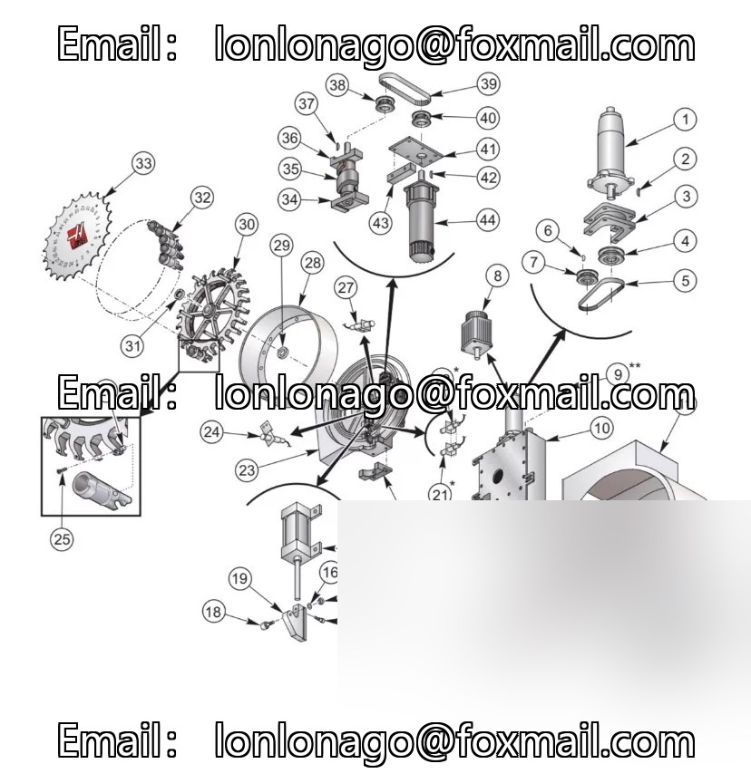
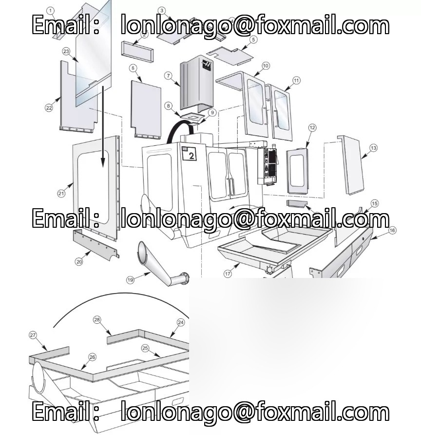
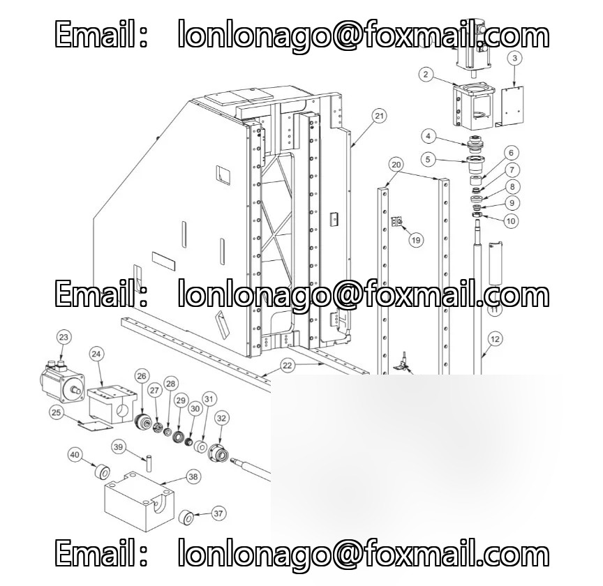
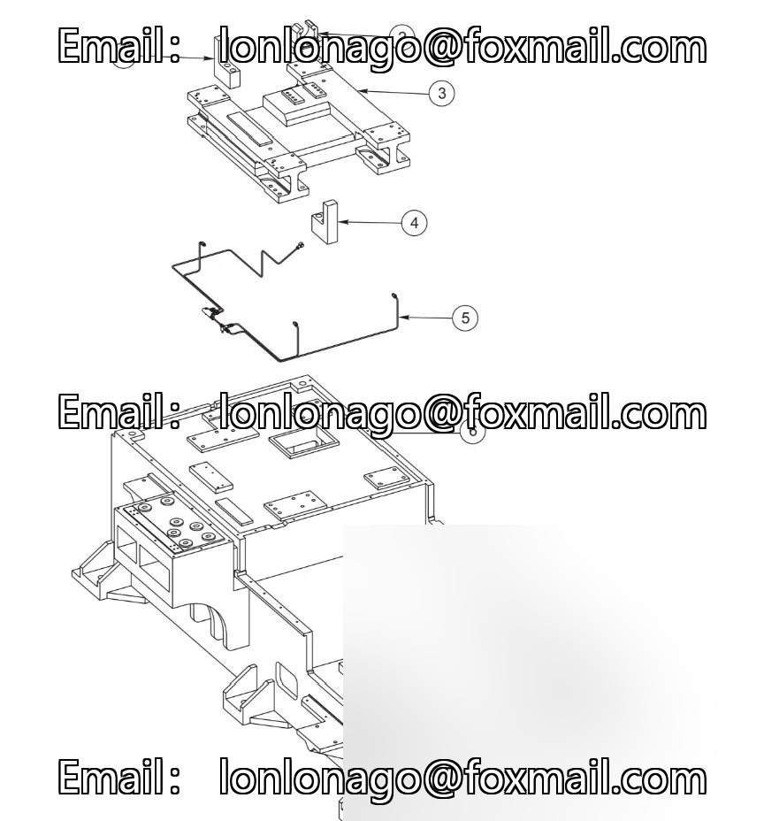
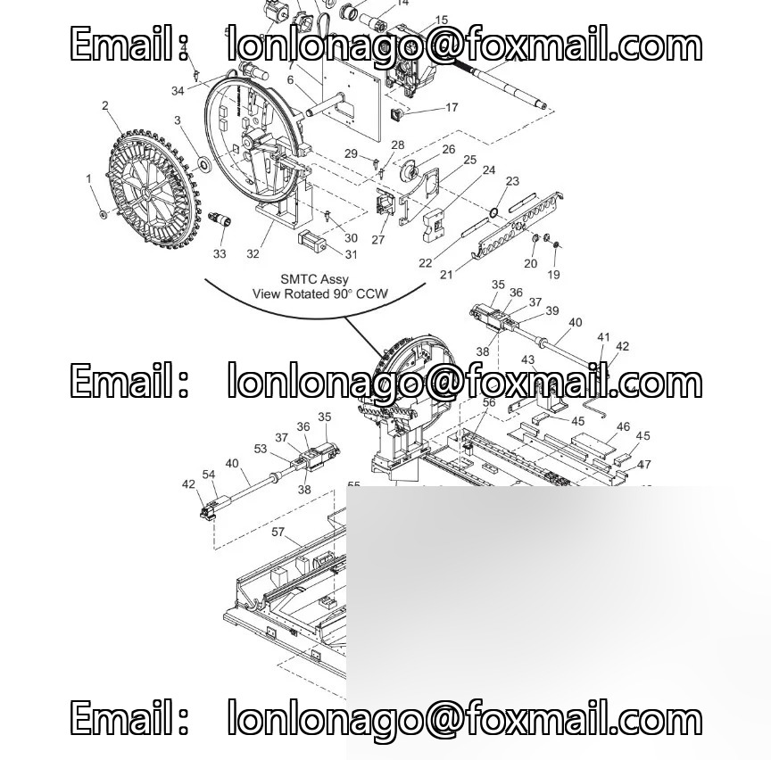
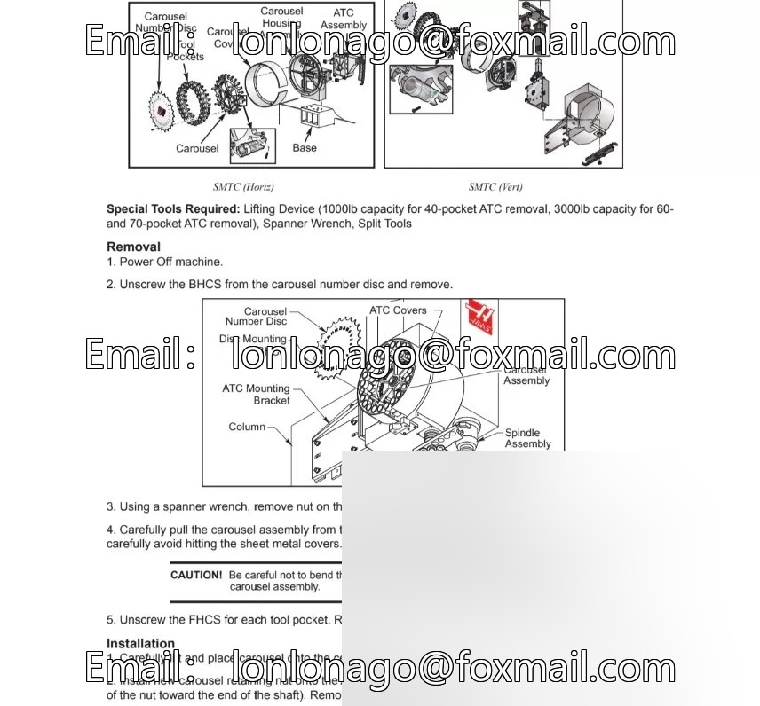

# PDF of the "Haas (Haas) CNC machine tool mechanical component service manual

## Body

《Haas (Haas) NC machine tool mechanical component service manual》PDF , 540 pages, almost covers all maintenance and troubleshooting guides for Haas all mechanical subsystems.
1. Core content
1. Trouble diagnosis and basic data
- Mechanical problem handling (vibration, precision, surface finish, thermal deformation)
- Air pressure/hydraulic parameter tables (spindle air pressure, clamping air pressure, hydraulic unit specifications)
2. Spindle system
- Lubrication, seal replacement
- Spindle motor, transmission gearbox disassembly/installation
- Orientation, cutter pulling force testing and adjustment
3. ATC system
- Tool library, tool change arm, cam, TRP disassembly/installation
- Orientation, action timing, problem resolution for cutter sticking
4. Transmission and guide rails

- Rolling ball screw disassembly, pre-stretch adjustment, reverse gap elimination
- Bearing, coupling centering
5. Rotating shaft and accessories
- 4/5 shaft brake, air pipeline valve block
- Tail pin centering and calibration
6. Lubrication and cooling
- Central lubrication pipe cleaning, oil inlet replacement
- Cooling system maintenance
II. Characteristics of materials
The system is comprehensive and practical, suitable for reference for HAS machine tool maintenance, repair, and upgrades.
copyable, non-refundable upon sale.
859844378

The Haas CNC machine tool mechanical component service manual PDF covers 540 pages, providing comprehensive maintenance, troubleshooting and service guidance for all Haas machine subsystems.

<!-- AI_ENRICHED -->

## Images

## Payment

Here is a pay link on Stripe ( https://buy.stripe.com/3cs8yP7sY87d0vu9AB ). Please contact me lonlonago@foxmail.com after funding $89, and I will send you a complete data files , thank you!

